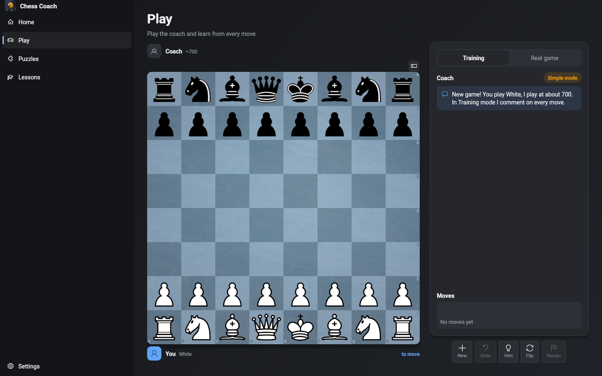
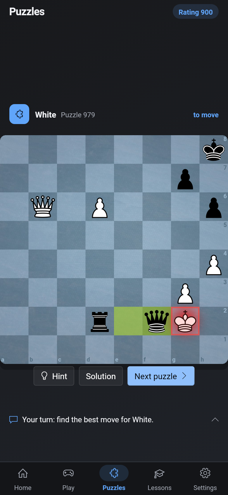

# Chess Coach

A free, open-source chess coach for **Android, Windows and Ubuntu**. It plays you at your level like a
human would, explains your mistakes in plain English, and builds a training plan that adapts to you.
Everything runs on your own device. No account, no ads, no tracking.

[**Download the latest version**](https://github.com/saad-rafeque/chess-coach/releases/latest) ·
[Website](https://saad-rafeque.github.io/chess-coach/) ·
[Privacy policy](https://saad-rafeque.github.io/chess-coach/privacy.html)

<p>
  
  
</p>

## What it does

- **A coach that plays like a person** at any strength from 400 to 3200, using the human-like
  [Maia](https://github.com/CSSLab/maia-chess) networks and Stockfish 19. It can pick the right strength for you.
- **Training mode** comments on every move, gives hints, and shows the better move when you slip.
- **Game review** with accuracy, key moments and arrows for the best moves.
- **30,000 puzzles** from the Lichess database, rated to your level, plus puzzles made from your own mistakes.
- **20 lessons** on openings, middlegames and endgames, with exercises.
- **A personal plan**: skill ratings per area, spaced-repetition review cards, and "I have 15 minutes" sessions.
- **Optional friendly explanations** from a small language model that runs on your device (download in Settings).
- **Sync through your own Google Drive** (optional). Each player connects their own account; the app keeps one
  small file in a hidden app folder of *their* Drive. There is no server, so nobody else can see your data.
- Light, Dark and Wooden themes; works with keyboard, screen readers and large text.

## Install

| Platform | File | How |
|---|---|---|
| Android | `ChessCoach-<version>-android-arm64.apk` | Open it on the phone and allow installing from this source |
| Windows | `ChessCoach-<version>-Setup.exe` | Run it; on a SmartScreen warning choose *More info → Run anyway* |
| Ubuntu | `ChessCoach-<version>-amd64.deb` | `sudo apt install ./ChessCoach-<version>-amd64.deb` |
| Any Linux | `ChessCoach-<version>-x86_64.AppImage` | `chmod +x` it and run |

Every release lists SHA-256 checksums in `SHA256SUMS.txt`, so you can check a download is exactly what was
built here: `sha256sum -c SHA256SUMS.txt --ignore-missing`.

## Privacy and security

- Your games and progress stay on your device (in `Documents/Chess Coach` on computers).
- Sync uses only the `drive.appdata` permission: the app can see its own hidden folder and nothing else in
  your Drive. Your sign-in is stored only on your device. Details: [privacy policy](https://saad-rafeque.github.io/chess-coach/privacy.html).
- Found a security problem? Please report it privately: see [SECURITY.md](SECURITY.md).

## Build it yourself

You need [Flutter](https://flutter.dev) 3.47, and on Linux the package `libsecret-1-dev` (the refresh
token is kept in the desktop keychain).

```bash
sudo apt install libsecret-1-dev   # Ubuntu / Debian
bash tool/fetch_engines.sh linux
flutter test
flutter run -d linux
```

Google Drive sync needs your own free Google OAuth client ("Desktop app"); without one the app works fully
and only sync is switched off. Setup steps: [docs/google-drive-sync.md](docs/google-drive-sync.md). The plan
and design notes are in [PLAN.md](PLAN.md) and [PROGRESS.md](PROGRESS.md).

## Contributing

Issues and pull requests are welcome. If Chess Coach helps you, please **star the repository** so more
players can find it.

## Licence

GPL-3.0 (see [LICENSE](LICENSE)). You may use, change and share it; versions you share must stay open source
under the same licence. Chess Coach builds on Stockfish, Maia, Lichess and more:
see [THIRD_PARTY_NOTICES.md](THIRD_PARTY_NOTICES.md).
